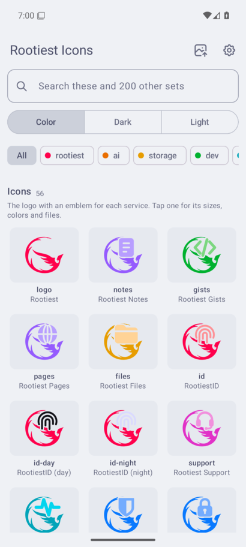
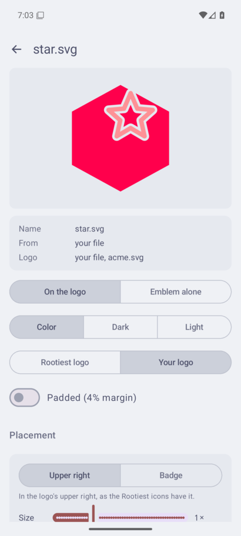
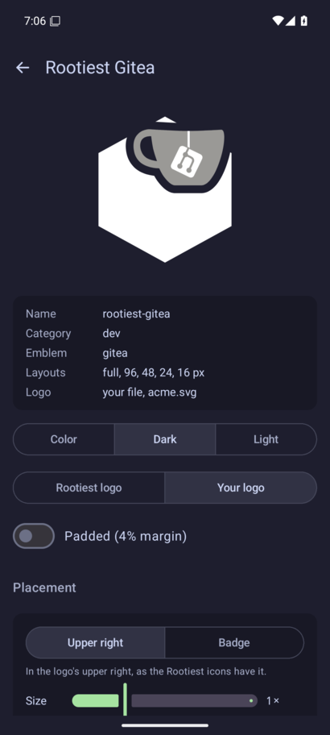
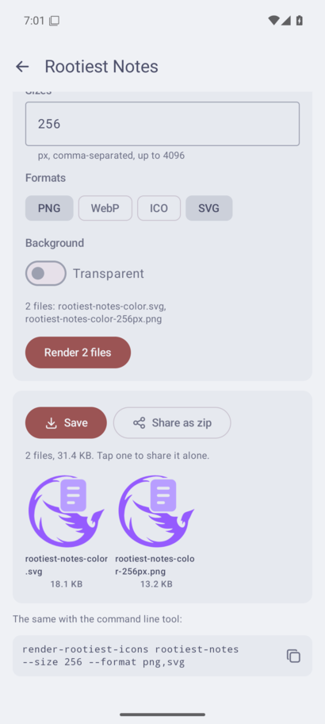

# rootiest-icons-android

Rootiest Icons for Android: the [icons.rootiest.fyi](https://icons.rootiest.fyi) catalogue and its Render panel as a
native app. Browse the Rootiest logo, service icons, status icons and emblems; build any icon from another set
(Tabler, Material, Simple Icons and some 200 more, through Iconify) or from an SVG of your own, on the Rootiest logo or
on a logo of your own; and render any of it at any size, in any layout and color, to PNG, WebP, ICO, SVG or GIF, even an
SVG, WebP or GIF that draws itself, beats like a heart monitor, pulses, spins, shakes, pops, shines or morphs into
another icon. Preview any icon in light or
dark mode, save the auto versions that switch by themselves, and read Drawn with Math, the site's interactive tour of
SVG, without leaving the app.

It builds every icon exactly as the [command line tool](https://icons.rootiest.fyi/#render),
`render-rootiest-icons`, does: the same placement, knockout, colors and file names, and each render shows the command
that writes the same files on a computer.

| | | | |
|---|---|---|---|
|  |  |  |  |

## Install

Android 10 or later. Get it from Google Play's closed test, or download the APK yourself. Both are signed with the
same key, so either one updates the other.

### Google Play (closed testing)

Rootiest Icons is in closed testing on Google Play. Anyone can join. Do all three steps with **the same Google
account your phone's Play Store uses**:

1. **Join** the [Rootiest Icons Google Group](https://groups.google.com/g/rootiest-icons).
2. **Opt in** to testing at
   [play.google.com/apps/testing/dev.rootiest.icons](https://play.google.com/apps/testing/dev.rootiest.icons). It
   works from any browser.
3. **Install** it from [Google Play](https://play.google.com/store/apps/details?id=dev.rootiest.icons). Updates then
   arrive like any other app's.

Please keep the app installed for at least **14 days**: Google needs that before the app can be published to
everyone.

- **Already got a "welcome to the group" email?** You're a member: go straight to step 2.
- **"Item not found" in the Play Store:** the Play Store is signed in to a different Google account than the one in
  the group. Switch accounts in the Play Store (tap your profile picture), then open the install link again.
- **The opt-in page says you can't join:** you're not in the group yet, or you just joined. Wait a few minutes and
  reload. Google can take up to an hour to pass new testers through.

The group is for announcements only. To report a problem, open **Settings → About → Report an issue** in the app, or go
to [support.rootiest.dev](https://support.rootiest.dev).

### APK and Obtainium

Install the APK from the
[releases page](https://git.rootiest.dev/rootiest/rootiest-icons-android/releases), or let
[Obtainium](https://github.com/ImranR98/Obtainium) install it and keep it updated: add the app with the URL
`https://git.rootiest.dev/rootiest/rootiest-icons-android` and the Forgejo source (Gitea serves the same releases
API). No token is needed.

Releases are signed with a certificate whose SHA-256 fingerprint is
`36:15:BB:5F:65:09:81:1F:A5:BB:82:83:03:B5:72:64:2C:36:3E:40:5A:F9:3D:47:75:23:27:9A:D0:EC:93:A4`.

## Setup

Clone the repository and enter it:

```sh
git clone https://git.rootiest.dev/rootiest/rootiest-icons-android.git
cd rootiest-icons-android
git config core.hooksPath .githooks
```

You need JDK 21 or newer and the Android SDK. Android Studio installs the SDK; without it, put the command-line tools
in `~/Android/Sdk/cmdline-tools/latest`, accept the licences (`sdkmanager --licenses`) and point the build at the SDK,
either with `ANDROID_HOME` or with `sdk.dir=/home/<you>/Android/Sdk` in `local.properties` (git-ignored). The build
downloads the platform and build tools it needs.

## Build and test

- Build: `./gradlew assembleDebug` writes `app/build/outputs/apk/debug/app-debug.apk`.
- Install on a connected phone or emulator: `./gradlew installDebug`.
- Test: `./tests/run-tests.sh` (the builder's JVM tests, then a debug build; no device). See
  [docs/README.md](docs/README.md#tests).
- Release: `scripts/release.sh` (see [docs/README.md](docs/README.md#releases)).

## Conventions

This project follows the Rootiest project conventions: branch before editing, never
push `main`, Conventional Commits, labeled PRs, docs as the single source of truth.
See [CONTRIBUTING.md](CONTRIBUTING.md).

## Documentation

Project documentation lives in [docs/](docs/README.md).

## Contributing

Read [CONTRIBUTING.md](CONTRIBUTING.md) before opening a pull request.

## License

Released under the GPL-3.0-or-later license. See [LICENSE](LICENSE).
